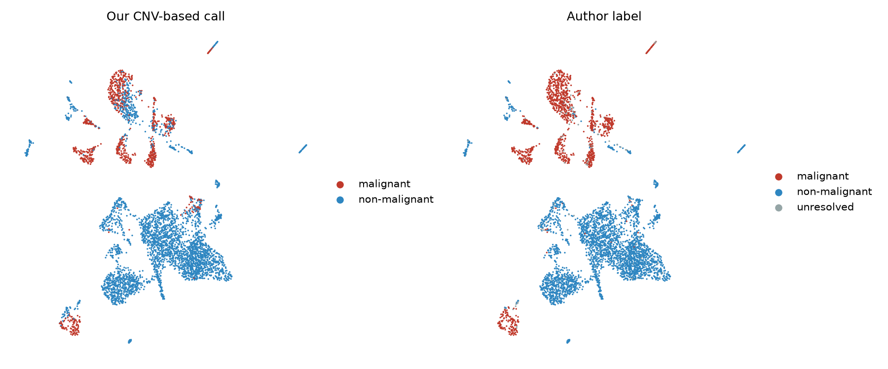
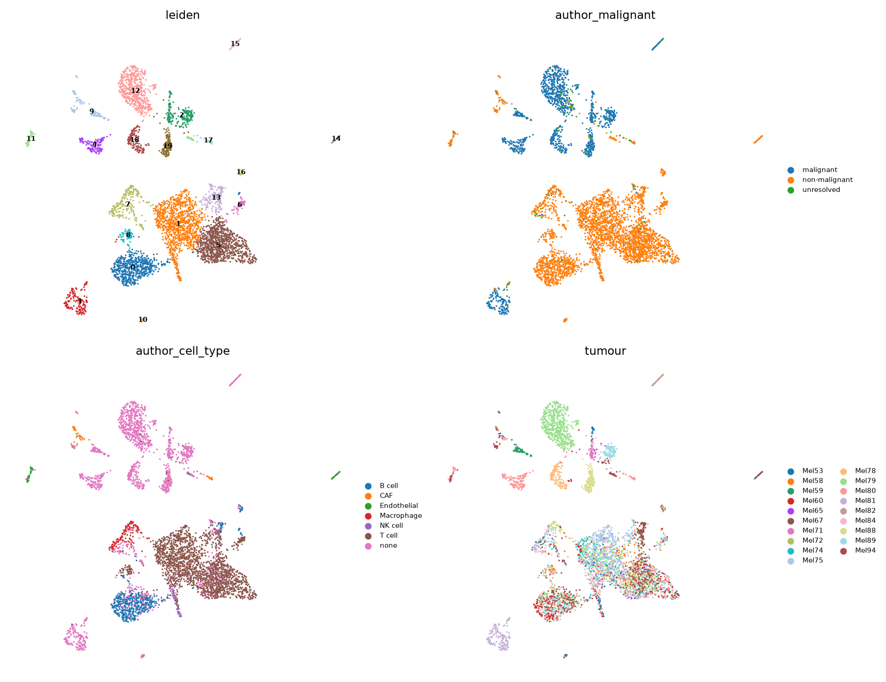
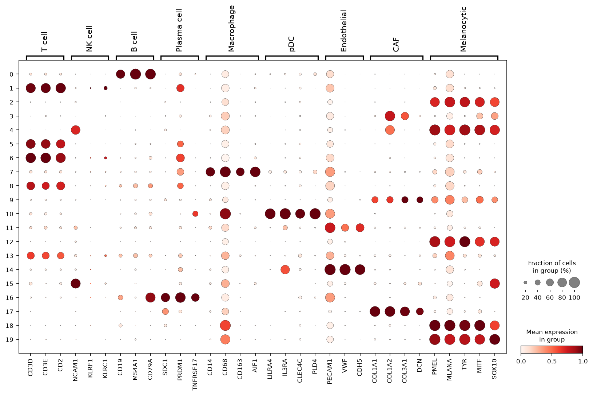
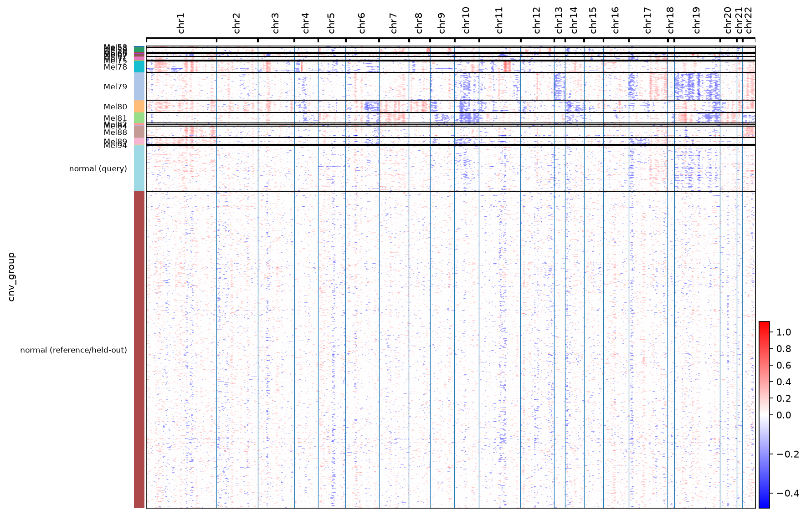
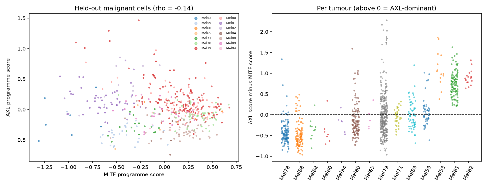

# melanoma-scrnaseq

**Separating malignant from non-malignant cells in human melanoma single-cell RNA-seq, and
asking how tumour cell states differ between patients.**

Reanalysis of Tirosh et al. 2016 (GEO [GSE72056](https://www.ncbi.nlm.nih.gov/geo/query/acc.cgi?acc=GSE72056)):
4,645 cells from 19 metastatic melanomas, profiled with Smart-seq2. The pipeline uses
Scanpy for QC, clustering and marker-based annotation, and infercnvpy to call malignant
cells from inferred copy-number changes. Every method choice and the reason for it is in
the [decision log](docs/decisions.md) (D1 to D24).



## Questions

1. Can standard single-cell steps (QC, clustering, marker annotation) recover the cell
   types in a melanoma tumour sample?
2. Can malignant cells be told apart from normal cells using **copy-number changes inferred
   from expression**, with normal immune and stromal cells as the reference? How well does
   this agree with the authors' labels?
3. Do malignant cells show the **MITF-high (differentiated) and AXL-high
   (undifferentiated)** states described by Tirosh et al., and how do they vary between
   patients? AXL-high states have been linked to resistance to BRAF/MEK inhibitors.

## Data

- One public file: `GSE72056_melanoma_single_cell_revised_v2.txt.gz` (75 MB), downloaded
  by `scripts/01_download.py`. It contains 4,645 cells x 23,686 genes, plus author labels
  for malignancy (1,257 malignant, 3,256 non-malignant, 132 unresolved) and six
  non-malignant cell types.
- Values are **log2(TPM/10 + 1), not raw counts**. I checked this: undoing the transform
  gives a median of 999,999 TPM per cell, as TPM should. The file has **no mitochondrial
  genes**, and the authors had already filtered cells. This changes the standard pipeline
  (no count normalisation, no scrublet, no mitochondrial QC), as explained in D3 and D6.
- Gene coordinates for CNV inference come from GENCODE v19 (hg19), the genome build of
  the original data.

## Methods

| Step | What | Key choices (decision) |
|---|---|---|
| QC | Outlier cells, doublets, rare genes | Median +/- 5 MADs on genes detected (D7); immune + melanocyte marker co-expression as a doublet check (D8); genes in at least 3 cells (D9) |
| Embedding | HVGs, PCA, neighbours, UMAP | 2,000 HVGs (Seurat flavour, valid on log data), 30 PCs, 15 neighbours (D11, D12) |
| Clustering | Leiden | Resolution 0.5, 20 clusters, no batch correction (D12, D13) |
| Annotation | Marker scores per cluster | Canonical marker lists, each label checked against the cluster's own top genes (D14 to D16) |
| Malignancy | infercnvpy | Reference = half of our immune/stromal cells, one baseline per cell type; HLA genes removed; thresholds from the other, held-out half (D17 to D21) |
| Cell states | MITF and AXL programmes | 50-gene programmes learned on half of the malignant cells, tested on the other half (D22 to D24) |

## Results

**QC.** 4,645 cells in, **4,619 kept** (26 removed as likely immune/melanoma doublets), with
22,285 genes after dropping 1,401 seen in fewer than 3 cells. No cells failed the
genes-detected filter. A stricter 3-MAD cut-off would have removed 31 malignant cells
simply because tumour cells detect more genes (median 5,523 vs 3,626).

**Clustering: tumour cells cluster by patient, normal cells do not.** In the 7 clusters
that are at least 80% malignant, a median of **99%** of cells come from one tumour. In the 12
mostly non-malignant clusters, the median is **28%**. This matches the original paper and
is why no batch correction was applied: it would remove real tumour-specific biology.



**Annotation: 93.7% agreement with author cell types** (2,681 of 2,861 cells). T cells
98.1%, B cells 90.9%, macrophages and endothelial cells 100%. The data also revealed 19
plasmacytoid dendritic cells and 25 plasma cells, which have no author category. Gaps:
**NK cells 0 of 51** (hidden inside a large cytotoxic T-cell cluster) and **CAFs 18 of 61**
(most sit in a mixed fibroblast/tumour cluster). 165 author-malignant cells were in
clusters no marker set could label, because they had switched off MITF and pigmentation
genes.



**CNV-based malignancy calls: agreement 91.5%, sensitivity 73.3%, specificity 98.6%** against
author labels (unresolved cells excluded). Only 1.4% of held-out normal cells were called
malignant. Sensitivity was at least 85% in 7 of 15 tumours but only 60% in the largest
tumour (Mel79), whose missed cells carry its CNV pattern more weakly than the strict
threshold. Most cells in the "unclear" de-differentiated clusters were malignant by copy
number.



A sensitivity analysis shows the trade-off: a pooled (not per-cell-type) reference raises
sensitivity to 89.8 to 94.6% but calls 26 to 27 fibroblast, endothelial or macrophage cells
malignant. I kept the stricter setting because those false positives would bias the AXL
analysis (fibroblasts express AXL).

**MITF vs AXL states: large differences between patients, weak link within tumours.** The
programmes were learned without labels and look biologically sensible. The MITF programme
includes MLANA, PMEL, TYR and GPR143. The AXL programme includes NGFR, TNC and LIF.
- Every result was repeated over **50 random learn/test splits**, because the first single
  split turned out to be fragile (D24).
- In Mel53 and Mel82, 100% of malignant cells are AXL-dominant in every split, and in Mel81
  the median is 100%. In Mel78 and Mel88 the medians are only 6% and 12%.
- Within tumours the two programmes are only **weakly anti-correlated: median Spearman
  rho = -0.13** (90% of splits between -0.23 and -0.02). It is negative in all 50 splits
  and significant (p < 0.05) in 78%. Correlations inside single tumours are not stable
  across splits, so I don't report them.



## Limitations

- **Processed TPM data.** There are no raw counts and no mitochondrial genes, and the cells
  were pre-filtered. QC here is mostly a confirmation step. This is not a demonstration of
  10x-style raw-count QC.
- **The author labels are not independent ground truth.** They were partly CNV-based, so
  agreement shows two CNV approaches agree.
- **Cluster-level annotation** misses small populations inside clusters (NK cells).
- **CNV calls are conservative.** About a quarter of author-malignant cells are missed,
  concentrated in a few tumours.
- **Small numbers of patients and cells.** 14 tumours had malignant cells, several with
  fewer than 20. There is no treatment data, so nothing here speaks to drug response
  directly.
- The CNV reference uses one random split (seed 0). The programme analysis was repeated
  over 50 splits, but the CNV step was not.

## Reproduce

Requires [uv](https://docs.astral.sh/uv/). It takes about 10 minutes on a laptop and downloads
113 MB.

```bash
git clone https://github.com/prithviraj-dasgupta/melanoma-scrnaseq
cd melanoma-scrnaseq
uv sync
bash scripts/run_pipeline.sh     # download -> QC -> clustering -> annotation -> CNV -> programmes
uv run pytest                    # 35 tests on small synthetic data (one checks the GEO link)
```

The story notebook is `notebooks/melanoma_story.ipynb`. It reads the pipeline's outputs.

## Repository layout

```
src/melscrna/     load, qc, cluster, annotate, cnv, programs (tested functions)
scripts/          01-07 pipeline steps and run_pipeline.sh
notebooks/        melanoma_story.ipynb
results/          figures/ and tables/ (committed)
docs/decisions.md every method choice, with the reason and the numbers
tests/            pytest, run in GitHub Actions on Python 3.11 and 3.12
```

## Reference

Tirosh I, Izar B, et al. Dissecting the multicellular ecosystem of metastatic melanoma by
single-cell RNA-seq. *Science* 352, 189-196 (2016).

## Licence

MIT. The data belong to the original authors and are downloaded from GEO, not
redistributed here.
